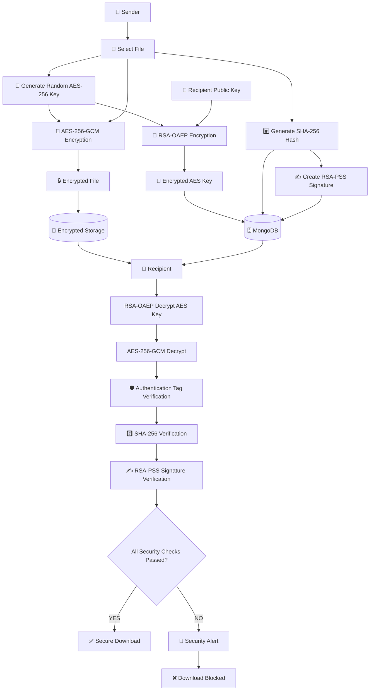
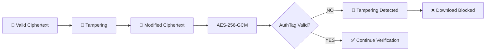
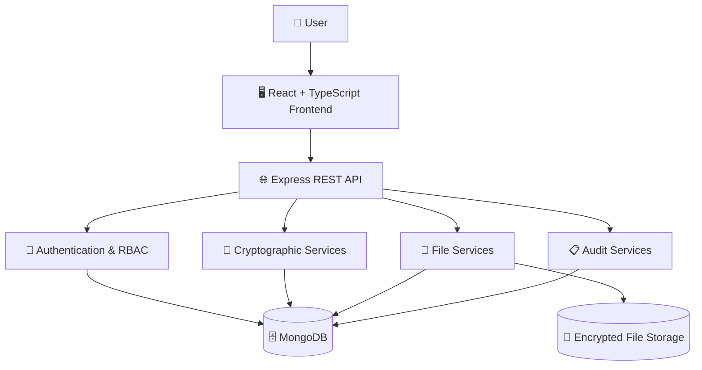

# 🔐 VeriCrypt

## Secure File Sharing & Integrity Verification Using Hybrid Cryptography

<p align="center">
  
  
  
  
  
  
</p>

<p align="center">
  <b>Encrypt • Verify • Detect • Protect</b>
</p>

---

## 📌 Overview

**VeriCrypt** is a full-stack secure file-sharing application developed as a **Cryptography and Network Security** project.

The system demonstrates how multiple cryptographic techniques can be combined to provide:

- 🔒 Confidentiality
- 🛡️ Integrity
- ✍️ Authenticity
- 🔑 Secure key management
- 👤 Authentication
- 🚦 Authorization
- ⚔️ Tamper detection
- 📋 Security auditing

Instead of using a single encryption algorithm, VeriCrypt implements a **hybrid cryptographic architecture** using symmetric encryption for files and asymmetric cryptography for secure key protection and digital signatures.

---

# ✨ Key Features

| Feature | Implementation |
|---|---|
| 🔐 File Encryption | AES-256-GCM |
| 🔑 Key Protection | RSA-OAEP |
| #️⃣ Integrity Verification | SHA-256 |
| ✍️ Digital Signature | RSA-PSS |
| 🛡️ Private-Key Protection | PBKDF2 + AES-GCM |
| 👤 Authentication | JWT + bcrypt |
| 🚦 Authorization | Role-Based Access Control |
| ⚔️ Tamper Simulation | Ciphertext modification |
| 🚨 Security Alerts | Failed verification detection |
| ⏳ File Expiration | Configurable expiration |
| 📋 Audit Logging | Security event tracking |
| 💾 Secure Storage | Encrypted `.enc` files |
| 🧪 Automated Testing | Crypto + API tests |

---

# 🎯 Project Objectives

The main objectives of VeriCrypt are:

1. Implement practical cryptographic algorithms.
2. Demonstrate hybrid encryption in a real application.
3. Protect files from unauthorized access.
4. Verify file integrity after transfer.
5. Authenticate the sender using digital signatures.
6. Demonstrate ciphertext tampering and attack detection.
7. Implement secure authentication and authorization.
8. Maintain security-related audit logs.
9. Analyze the security properties and trade-offs of the system.

---

# 🔄 Complete Cryptographic Workflow



---

# 🔐 Hybrid Cryptography

VeriCrypt uses a **hybrid cryptographic model**.

The large file is encrypted using **AES-256-GCM**, while the AES session key is protected using **RSA-OAEP**.

```text
                    📄 ORIGINAL FILE
                           │
                           ▼
                   AES-256-GCM
                           │
                           ▼
                  🔒 ENCRYPTED FILE
                           
                           
             🎲 RANDOM AES-256 KEY
                           │
                           ▼
                       RSA-OAEP
                           │
                           ▼
                  🔐 ENCRYPTED AES KEY
```

### Why Hybrid Encryption?

RSA is not designed for efficiently encrypting large files.

Therefore:

```text
❌ File → RSA

Instead:

✅ File → AES-256-GCM
✅ AES Key → RSA-OAEP
```

This combines the performance of symmetric encryption with the secure key-distribution properties of asymmetric cryptography.

---

# 🧩 Cryptographic Algorithms

| Algorithm       | Type              | Purpose                |
| --------------- | ----------------- | ---------------------- |
| **AES-256-GCM** | Symmetric / AEAD  | File encryption        |
| **RSA-OAEP**    | Asymmetric        | AES key protection     |
| **SHA-256**     | Hash              | File integrity         |
| **RSA-PSS**     | Digital Signature | Sender authenticity    |
| **PBKDF2**      | KDF               | Private-key protection |
| **bcrypt**      | Password Hashing  | User password security |

---

# 🔎 Security Verification Pipeline

VeriCrypt does not consider a file safe merely because it can be decrypted.

Multiple checks are performed before allowing download.

```text
             🔐 Encrypted AES Key
                     │
                     ▼
              RSA-OAEP Decrypt
                     │
                     ▼
                AES-256 Key
                     │
                     ▼
              AES-GCM Decrypt
                     │
                     ▼
             Authentication Tag
                     │
                     ▼
                SHA-256
                     │
                     ▼
             Hash Comparison
                     │
                     ▼
                RSA-PSS
                     │
                     ▼
          Signature Verification
                     │
             ┌───────┴───────┐
             ▼               ▼
          ✅ PASS          ❌ FAIL
             │               │
             ▼               ▼
      Secure Download     🚨 Block
```

---

# ⚔️ Tamper Detection

VeriCrypt includes a deliberate **tampering simulation** to demonstrate an attack and its corresponding defense.

## Normal Operation

```text
📄 Original File
      ↓
🔐 AES-256-GCM
      ↓
🔒 Encrypted File
      ↓
🛡️ Verification
      ↓
✅ Download Allowed
```

## Tampering Attack

```text
🔒 Encrypted File
      ↓
🔨 Ciphertext Modification
      ↓
💾 Modified Encrypted File
      ↓
🛡️ AES-GCM Verification
      ↓
❌ Authentication Tag Failure
      ↓
🚨 Security Alert
      ↓
🚫 Download Blocked
```

### Attack Visualization



---

# 🛡️ Defense-in-Depth

VeriCrypt does not depend on a single security mechanism.

```text
                    🔐 VeriCrypt
                         │
        ┌────────────────┼────────────────┐
        │                │                │
        ▼                ▼                ▼
   Identity          Cryptography      Application
   Security            Security          Security
        │                │                │
        ├─ JWT           ├─ AES-GCM       ├─ Helmet
        ├─ bcrypt        ├─ RSA-OAEP      ├─ CORS
        ├─ RBAC          ├─ RSA-PSS       ├─ Rate Limit
        └─ Auth          ├─ SHA-256       ├─ File Limits
                         └─ PBKDF2        └─ Validation
```

---

# 🔑 Private-Key Protection

RSA private keys are protected before storage.

```text
👤 User Password
       │
       ▼
PBKDF2 + SHA-256
       │
       ▼
🔑 Derived Encryption Key
       │
       ▼
AES-256-GCM
       │
       ▼
🔐 Encrypted RSA Private Key
       │
       ▼
🗄️ Database
```

The protected key package contains values such as:

```text
Salt
IV
Authentication Tag
Encrypted Private Key
```

---

# ⏳ File Expiration

Files can be configured with an expiration period.

```text
⏱️ 1 Hour
⏱️ 24 Hours
⏱️ 7 Days
♾️ Never
```

After expiration:

```text
Expired File
     ↓
Authorization Check
     ↓
🚫 Access Denied
     ↓
HTTP 410 Gone
```

---

# 👤 Authentication & Authorization

VeriCrypt uses multiple layers of account security.

```text
User
 │
 ▼
Login
 │
 ▼
bcrypt Password Verification
 │
 ▼
JWT Token
 │
 ▼
Role Verification
 │
 ├──────────────┬──────────────┐
 ▼              ▼              ▼
👤 Customer    👨‍💼 Admin      🔐 Protected API
```

### Security mechanisms

* JWT authentication
* bcrypt password hashing
* Role-Based Access Control
* Protected API routes
* Authorization middleware
* Request validation
* Rate limiting

---

# 📋 Audit Logging

Security-relevant events are recorded for traceability.

Examples include:

```text
LOGIN
LOGOUT
FILE_UPLOAD
FILE_DOWNLOAD
FILE_SHARE
FILE_VERIFICATION
TAMPER_DETECTED
ACCESS_DENIED
FILE_EXPIRED
```

Example:

```json
{
  "event": "TAMPER_DETECTED",
  "user": "recipient",
  "file": "document.pdf",
  "timestamp": "2026-10-01T12:00:00Z",
  "result": "BLOCKED"
}
```

---

# 🧪 Security Testing

Run the automated tests with:

```bash
cd backend
npm test
```

### Test Categories

```text
✅ AES Encryption / Decryption
✅ RSA-OAEP Key Encryption / Decryption
✅ SHA-256 Hashing
✅ RSA-PSS Signature Generation
✅ RSA-PSS Signature Verification
❌ Invalid Signature Detection
❌ Wrong Key Detection
❌ Modified Ciphertext Detection
❌ Modified AuthTag Detection
❌ Unauthorized Access
❌ Expired File Access
✅ End-to-End File Sharing
```

---

# 📊 Security Properties

| Security Property         | Mechanism              |
| ------------------------- | ---------------------- |
| 🔒 Confidentiality        | AES-256-GCM            |
| 🛡️ Integrity             | AES-GCM + SHA-256      |
| ✍️ Authenticity           | RSA-PSS                |
| 🔑 Key Protection         | RSA-OAEP               |
| 🔐 Private-Key Protection | PBKDF2 + AES-GCM       |
| 👤 Authentication         | JWT + bcrypt           |
| 🚦 Authorization          | RBAC                   |
| ⚔️ Tamper Detection       | GCM Authentication Tag |
| 📋 Accountability         | Audit Logging          |

---

# 🏗️ System Architecture



---

# 🧱 Application Modules

```text
VeriCrypt
│
├── 🔑 Authentication
│   ├── Registration
│   ├── Login
│   ├── JWT
│   └── Password Security
│
├── 📁 File Sharing
│   ├── Upload
│   ├── Encryption
│   ├── Sharing
│   ├── Download
│   └── Expiration
│
├── 🔐 Cryptographic Engine
│   ├── AES-256-GCM
│   ├── RSA-OAEP
│   ├── RSA-PSS
│   ├── SHA-256
│   └── PBKDF2
│
├── 🛡️ Verification
│   ├── AuthTag Verification
│   ├── Hash Verification
│   ├── Signature Verification
│   └── Tamper Detection
│
├── 📋 Audit
│   ├── Security Events
│   └── Activity Logs
│
└── 👑 Administration
    ├── User Management
    ├── Security Monitoring
    └── Audit Review
```

---

# 📂 Project Structure

```text
cryptoshare/
│
├── backend/
│   ├── src/
│   │   ├── config/
│   │   ├── controllers/
│   │   ├── middleware/
│   │   ├── models/
│   │   ├── routes/
│   │   ├── services/
│   │   │   ├── crypto/
│   │   │   ├── files/
│   │   │   ├── users/
│   │   │   ├── auth/
│   │   │   └── audit/
│   │   ├── app.ts
│   │   └── server.ts
│   │
│   ├── tests/
│   ├── uploads/
│   └── package.json
│
├── frontend/
│   ├── src/
│   │   ├── components/
│   │   ├── context/
│   │   ├── pages/
│   │   ├── services/
│   │   ├── types/
│   │   ├── App.tsx
│   │   └── main.tsx
│   │
│   └── package.json
│
├── docs/
│   ├── 01-project-overview.md
│   ├── 02-system-architecture.md
│   ├── 03-cryptographic-algorithms.md
│   ├── 04-database-design.md
│   ├── 05-api-documentation.md
│   ├── 06-security-analysis.md
│   └── 07-testing.md
│
└── README.md
```

---

# 🛠️ Technology Stack

## Frontend

* React 18
* TypeScript
* Vite
* Tailwind CSS
* Axios
* Lucide Icons

## Backend

* Node.js 20+
* Express.js
* TypeScript
* Mongoose
* JWT
* bcrypt
* Multer
* Helmet
* Express Rate Limit

## Database

* MongoDB
* MongoDB Memory Server

## Cryptography

* AES-256-GCM
* RSA-OAEP
* RSA-PSS
* SHA-256
* PBKDF2
* bcrypt

---

# ⚙️ Installation

## Requirements

* Node.js `20+`
* npm `10+`
* MongoDB / MongoDB Atlas

---

## Backend

```bash
cd backend
npm install
npm run dev
```

Backend:

```text
http://localhost:5000
```

---

## Frontend

```bash
cd frontend
npm install
npm run dev
```

Frontend:

```text
http://localhost:5173
```

---

# 🔧 Environment Variables

Create a `.env` file inside the backend directory.

```env
PORT=5000
MONGODB_URI=your_mongodb_connection_string
JWT_SECRET=your_jwt_secret
```

> Never commit real secrets, private keys, database credentials, or production environment variables to GitHub.

---

# 🎬 Recommended Demo Flow

The complete demonstration can be performed using the following sequence:

```text
1️⃣ Register / Login
        ↓
2️⃣ Generate / Load RSA Keys
        ↓
3️⃣ Select File
        ↓
4️⃣ Select Recipient
        ↓
5️⃣ Set Expiration
        ↓
6️⃣ Encrypt & Send
        ↓
7️⃣ Recipient Opens File
        ↓
8️⃣ RSA-OAEP Key Recovery
        ↓
9️⃣ AES-GCM Decryption
        ↓
🔟 Integrity Verification
        ↓
1️⃣1️⃣ RSA-PSS Signature Verification
        ↓
1️⃣2️⃣ Secure Download
```

### Tampering Demonstration

```text
Upload
  ↓
Encrypt
  ↓
Send
  ↓
Verify → ✅
  ↓
Simulate Tampering
  ↓
Verify Again
  ↓
🚨 Tampering Detected
  ↓
❌ Download Blocked
```

---

# 📸 Screenshots & Demo

Create the following directory:

```text
docs/
└── assets/
    ├── dashboard.png
    ├── login.png
    ├── send-file.png
    ├── received-files.png
    ├── verification.png
    ├── tamper-detection.png
    └── cryptashare-demo.gif
```

## 🔑 Login

<p align="center">
  
</p>

## 🖥️ Dashboard

<p align="center">
  
</p>

## 📤 Secure File Sharing

<p align="center">
  
</p>

## 🛡️ Verification

<p align="center">
  
</p>

## ⚔️ Tamper Detection

<p align="center">
  
</p>

## 🎬 Application Demo

<p align="center">
  
</p>

---

# 📚 Documentation

Detailed technical documentation is available in the `docs/` directory.

| Document                         | Description                      |
| -------------------------------- | -------------------------------- |
| `01-project-overview.md`         | Project overview and objectives  |
| `02-system-architecture.md`      | System architecture and workflow |
| `03-cryptographic-algorithms.md` | Cryptographic algorithms         |
| `04-database-design.md`          | Database structure               |
| `05-api-documentation.md`        | REST API documentation           |
| `06-security-analysis.md`        | Security analysis                |
| `07-testing.md`                  | Testing and validation           |

---

# 🎓 Cryptography & Network Security Relevance

VeriCrypt directly demonstrates practical implementation of:

```text
🔐 Symmetric Cryptography
🔑 Asymmetric Cryptography
🔒 Hybrid Encryption
#️⃣ Cryptographic Hashing
✍️ Digital Signatures
🛡️ Integrity Verification
👤 Authentication
🚦 Authorization
🔑 Key Management
⚔️ Attack Simulation
🚨 Tamper Detection
📋 Security Auditing
```

### Project Mapping

| Academic Requirement     | VeriCrypt Implementation             |
| ------------------------ | -------------------------------------- |
| Algorithm Implementation | AES, RSA, SHA-256, PBKDF2              |
| Secure Application       | Full-stack secure file sharing         |
| Attack Simulation        | Ciphertext tampering                   |
| Defense Mechanism        | GCM AuthTag + SHA-256 + RSA-PSS        |
| Security Analysis        | Threats, controls and trade-offs       |
| Working Prototype        | React + Node.js application            |
| Testing                  | Automated cryptographic tests          |
| Documentation            | Architecture + algorithm documentation |

---

# ⚖️ Security Trade-offs

| Design          | Advantage                              | Trade-off                               |
| --------------- | -------------------------------------- | --------------------------------------- |
| AES-256-GCM     | Fast authenticated encryption          | Requires correct IV management          |
| RSA-OAEP        | Secure asymmetric key protection       | Computationally expensive               |
| RSA-PSS         | Strong digital signatures              | Higher computation than hashing         |
| SHA-256         | Fast integrity digest                  | Hash alone does not authenticate sender |
| PBKDF2          | Makes password guessing more expensive | Adds derivation overhead                |
| Audit Logs      | Better traceability                    | Additional storage                      |
| File Expiration | Limits long-term access                | Requires expiration checks              |

---

# 🧠 What Makes VeriCrypt Different?

VeriCrypt is not simply:

```text
Upload → Encrypt → Download
```

It implements a complete security workflow:

```text
          🔐 CONFIDENTIALITY
                 │
          AES-256-GCM
                 │
                 ▼
          🔑 KEY SECURITY
                 │
            RSA-OAEP
                 │
                 ▼
            INTEGRITY
                 │
          SHA-256 + GCM
                 │
                 ▼
           AUTHENTICITY
                 │
             RSA-PSS
                 │
                 ▼
         ⚔️ ATTACK DETECTION
                 │
                 ▼
          🚨 SECURITY ALERT
                 │
                 ▼
          🛡️ PROTECTED FILE
```

---

# 🔬 Possible Research Extensions

Future versions can explore:

* [ ] ECC-based key management
* [ ] X25519 key exchange
* [ ] Ed25519 digital signatures
* [ ] Client-side encryption
* [ ] End-to-end encrypted file sharing
* [ ] Key rotation
* [ ] Key revocation
* [ ] Hardware-backed key storage
* [ ] WebAuthn / Passkeys
* [ ] Cloud object storage
* [ ] Docker deployment
* [ ] HTTPS production deployment
* [ ] Performance benchmarking
* [ ] Advanced security monitoring

---

# 📈 Future Performance Analysis

Possible experiments include:

### Symmetric Encryption

```text
AES-128-GCM
      vs
AES-256-GCM
      vs
ChaCha20-Poly1305
```

Measure:

* Encryption time
* Decryption time
* Throughput
* CPU usage
* Memory usage

### Asymmetric Cryptography

```text
RSA-2048
   vs
RSA-3072
   vs
ECC
```

Measure:

* Key generation time
* Encryption / encapsulation time
* Signature generation
* Signature verification

---

# 🏆 Project Highlights

```text
🔐 AES-256-GCM File Encryption
🔑 RSA-OAEP Hybrid Key Protection
#️⃣ SHA-256 Integrity Verification
✍️ RSA-PSS Digital Signatures
🛡️ PBKDF2 Private-Key Protection
🔒 bcrypt Password Hashing
👤 JWT Authentication
🚦 Role-Based Access Control
⚔️ Tamper Attack Simulation
🚨 Automatic Tamper Detection
📋 Security Audit Logging
⏳ File Expiration
💾 Encrypted File Storage
🧪 Automated Security Testing
🌐 Full-Stack Web Application
```

---

# 🔐 Security Principle

> **Never trust encrypted data blindly. Verify it before releasing it.**

```text
             RECEIVE FILE
                  │
                  ▼
            🔑 Recover Key
                  │
                  ▼
            🔓 Decrypt File
                  │
                  ▼
            🛡️ Verify Integrity
                  │
                  ▼
          ✍️ Verify Authenticity
                  │
             ┌────┴────┐
             ▼         ▼
           PASS      FAILURE
             │         │
             ▼         ▼
        ✅ DOWNLOAD   🚨 BLOCK
```

---

# 👨‍💻 Author

## Laksh Suthar

**Computer Science & Engineering**
JSS Academy of Technical Education

---

<p align="center">

### 🔐 VeriCrypt

**Encrypt. Verify. Detect. Protect.**

</p>

<p align="center">

⭐ Star the repository if you find it useful.

</p>

---
