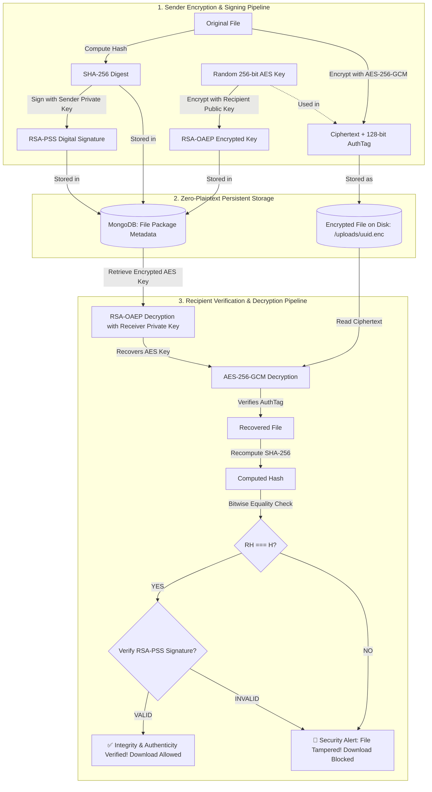

# CryptaShare — Secure File Sharing and Integrity Verification Using Hybrid Cryptography

[](https://nodejs.org/)
[](https://opensource.org/licenses/MIT)
[]()

> **A Complete Production-Grade Computer Science / Cryptography & Network Security Project**  
> Demonstrating confidential, authentic, integrity-verified, and tamper-evident file sharing using **AES-256-GCM**, **RSA-OAEP**, **SHA-256**, **RSA-PSS**, and **Zero-Plaintext Storage**.

---

## 1. Problem Statement & Objectives

Traditional cloud storage and file-sharing mechanisms routinely suffer from architectural vulnerabilities:
- **Plaintext Storage at Rest:** Service operators hold master decryption keys, leaving data vulnerable to rogue insiders, data breaches, or physical disk seizures.
- **Asymmetric Encryption Payload Limitations:** Asymmetric algorithms like RSA cannot encrypt files larger than their modulus length ($< 190$ bytes for 2048-bit keys), requiring hybrid architectures.
- **Lack of Non-Repudiation & Authenticity:** Symmetric keys alone cannot prove who originated a document.
- **Silent Tampering:** Without authenticated encryption tags and pre-encryption hashes, bit-rot and malicious modifications go completely undetected.

**CryptaShare** solves these challenges by combining:
1. **AES-256-GCM** for high-performance symmetric payload encryption.
2. **RSA-OAEP** for recipient public-key encapsulation of ephemeral session keys.
3. **SHA-256** for bitwise integrity verification.
4. **RSA-PSS** for digital signatures and non-repudiation.
5. **PBKDF2 (100,000 iterations) + AES-256-GCM** to ensure private keys are **never stored as plaintext**.

---

## 2. Core Hybrid Encryption Architecture

```
Large File Payload
       │
       ▼
[AES-256-GCM] ───────────────► [Encrypted File Blob on Disk (.enc)]
       ▲
       │
Random 256-bit AES Key
       │
       ▼
[RSA-OAEP Encrypt using Recipient Public Key]
       │
       ▼
[Encrypted AES Session Key in DB Package]
```

### Retrieval & Decryption Pipeline:
```
[Encrypted AES Key] ──► [RSA-OAEP Decrypt using Recipient Private Key] ──► [Recovered AES Key]
                                                                                   │
[Encrypted File Blob] ─────────────────────────────────────────────────────────────┘
       │
       ▼
[AES-256-GCM Decrypt & AuthTag Check]
       │
       ▼
[Decrypted File Buffer]
       │
       ├─► Compute SHA-256 ──► Compare with Stored Hash: [Integrity Verified]
       │
       └─► Verify RSA-PSS Signature against Sender Public Key: [Authenticity Verified]
```

---

## 3. Cryptographic Workflow Breakdown



---

## 4. Key Security Implementations

### 4.1 Private Key Protection (Zero Plaintext Private Keys)
When a user registers:
1. A fresh 2048-bit (or 3072-bit) RSA Keypair is generated in memory.
2. The user's master password is passed into **PBKDF2** with 100,000 iterations of SHA-256 and a 16-byte random salt to derive a 256-bit wrapping key.
3. The RSA private key PEM is encrypted with **AES-256-GCM** using a 12-byte IV and producing a 16-byte authentication tag.
4. Only the JSON bundle `{ salt, iv, authTag, encryptedData }` is persisted to the database.

### 4.2 Tampering Demonstration Feature (College Lab Requirement)
To demonstrate the effectiveness of cryptographic integrity protection:
1. Any authenticated user or administrator can click **"Simulate File Tampering"** on any file package.
2. The server flips random bits inside the stored `.enc` file on disk.
3. When the recipient attempts to verify or download the file:
   - **AES-256-GCM** immediately detects that the authentication tag does not match the modified ciphertext blocks.
   - The SHA-256 hash comparison fails.
   - The UI displays a prominent **"SECURITY ALERT: File integrity verification failed"** warning.
   - The backend returns HTTP `422 Unprocessable Entity` and **strictly blocks download**.

### 4.3 Time-Based Access Expiration
Senders can select an expiration timeframe:
- 1 Hour
- 24 Hours
- 7 Days
- Never

After expiration:
- Backend authorization middleware returns `410 Gone`.
- UI displays a gray `Expired` badge.
- Download access is permanently revoked.

---

## 5. Technology Stack

- **Backend:** Node.js (v20+), Express.js, TypeScript
- **Database:** MongoDB via Mongoose (with embedded `mongodb-memory-server` zero-setup fallback)
- **Cryptography Engine:** Built-in Node.js `crypto` API (OpenSSL FIPS-compliant primitives)
- **Password Security:** `bcryptjs` (Cost factor 12)
- **Authentication:** JSON Web Tokens (JWT) & Role-Based Access Control
- **Security Middleware:** Helmet, CORS, Express-Rate-Limit, Multer (Memory Storage)
- **Frontend:** React 18, TypeScript, Vite, Tailwind CSS, Lucide Icons

---

## 6. Directory Structure

```
cryptashare/
├── backend/
│   ├── src/
│   │   ├── config/              # Environment & MongoDB connection (with in-memory fallback)
│   │   ├── controllers/         # Auth, File, User, Audit controllers
│   │   ├── middleware/          # JWT authentication, RBAC, Rate limiting
│   │   ├── models/              # Mongoose schemas: User, File, AuditLog
│   │   ├── routes/              # Express route routers
│   │   ├── services/
│   │   │   ├── crypto/          # Core cryptographic engine (AES, RSA, SHA, PSS)
│   │   │   ├── files/           # File lifecycle, storage, and tampering demo
│   │   │   ├── users/           # User management and statistics
│   │   │   ├── audit/           # Security audit event logging
│   │   │   └── auth/            # Registration, login, and key generation
│   │   ├── app.ts               # Express application configuration
│   │   └── server.ts            # Entrypoint & default account seeding
│   ├── tests/                   # Jest automated test suites
│   ├── uploads/                 # Encrypted ciphertext storage (.enc)
│   ├── .env.example             # Template environment variables
│   └── package.json
│
├── frontend/
│   ├── src/
│   │   ├── components/          # Navbar, StatusBadge, VerificationModal
│   │   ├── context/             # AuthContext (JWT & session state)
│   │   ├── pages/               # Login, Register, Dashboard, Send, Received, Sent, Details, Logs, Admin, Profile
│   │   ├── services/            # Axios API client
│   │   ├── types/               # TypeScript interfaces
│   │   ├── App.tsx              # Router & Protected routes
│   │   └── main.tsx
│   └── package.json
│
└── docs/                        # Complete Academic Documentation
    ├── 01-project-overview.md
    ├── 02-system-architecture.md
    ├── 03-cryptographic-algorithms.md
    ├── 04-database-design.md
    ├── 05-api-documentation.md
    ├── 06-security-analysis.md
    └── 07-testing.md
```

---

## 7. Installation & Quick Start

### Prerequisites
- Node.js version 20 or higher
- npm version 10 or higher

### Step 1: Install Backend Dependencies
```bash
cd backend
npm install
```

### Step 2: Install Frontend Dependencies
```bash
cd ../frontend
npm install
```

### Step 3: Run Backend Server
```bash
cd ../backend
npm run dev
```
> **Note:** CryptaShare includes an embedded in-memory MongoDB fallback. It connects to local/cloud MongoDB if `MONGODB_URI` is provided, or seamlessly boots an embedded zero-setup database if no external database is configured.

The backend boots at: `http://localhost:5000`

### Step 4: Run Frontend Client
In a separate terminal:
```bash
cd frontend
npm run dev
```
The frontend UI will be accessible at: `http://localhost:5173`

---

## 8. Default Seed Accounts

When the application boots for the first time, three default accounts are automatically initialized:

| Account Type | Email | Password | Role |
|---|---|---|---|
| **Sender** | `alice@cryptashare.io` | `Password123!` | USER |
| **Receiver** | `bob@cryptashare.io` | `Password123!` | USER |
| **System Admin** | `admin@cryptashare.io` | `AdminPassword123!` | ADMIN |

*(One-click demo buttons are provided on the login page for convenience during evaluation).*

---

## 9. Running Automated Tests

Run the full cryptographic and end-to-end integration test suite:
```bash
cd backend
npm test
```

Or run individual suites:
```bash
# Cryptographic primitives unit tests
npx jest tests/crypto.test.ts

# End-to-end integration & tampering tests
npx jest tests/api.test.ts
```

---

## 10. College Demonstration Checklist

1. **User Registration:** Register a new user and observe in the console/profile that an RSA-2048 keypair is generated and the private key is encrypted with PBKDF2 + AES-GCM.
2. **Hybrid Transfer:** Log in as Alice (`alice@cryptashare.io`), navigate to **Send File**, select a document (e.g. PDF/DOCX), select recipient Bob (`bob@cryptashare.io`), and click **Encrypt & Send**.
3. **Zero Plaintext Inspection:** Inspect the backend `uploads/` folder. The file on disk is an unreadable `.enc` ciphertext blob.
4. **Verification & Download:** Log in as Bob (`bob@cryptashare.io`), navigate to **Received Files**, click **Verify & Download**, enter Bob's password, and watch all 4 cryptographic checks succeed before the file downloads.
5. **Tampering Demonstration:** Navigate to the file package details page, click **"Simulate File Tampering"**. Then attempt verification: the system triggers a **SECURITY ALERT**, displays the integrity failure reason, and blocks download.
