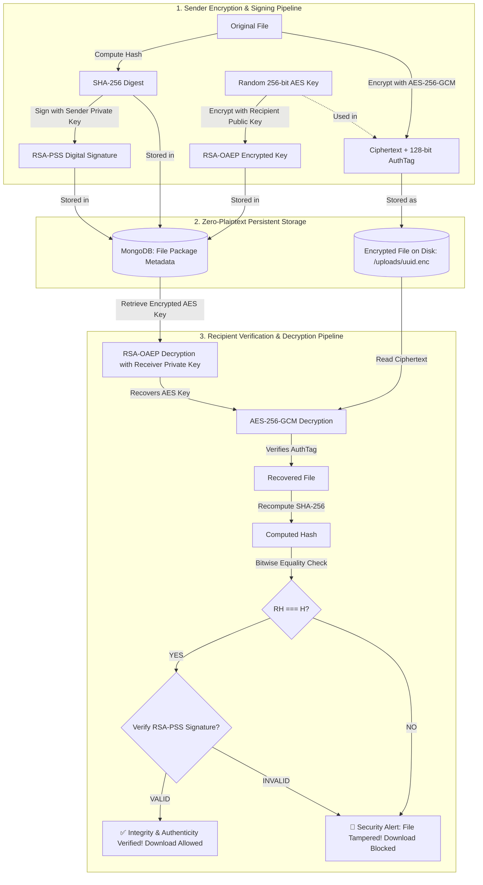
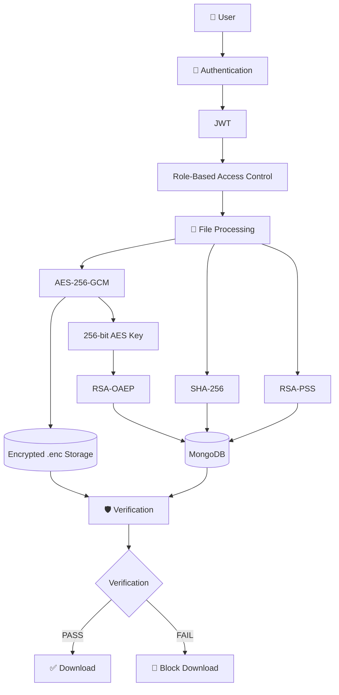
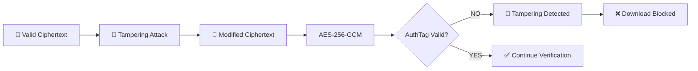

# CryptaShare — Secure File Sharing and Integrity Verification Using Hybrid Cryptography

[](https://nodejs.org/)
[](https://opensource.org/licenses/MIT)
[]()

> **A Complete Production-Grade Computer Science / Cryptography & Network Security Project**  
> Demonstrating confidential, authentic, integrity-verified, and tamper-evident file sharing using **AES-256-GCM**, **RSA-OAEP**, **SHA-256**, **RSA-PSS**, and **Zero-Plaintext Storage**.

---

AES-256-GCM for file encryption, RSA-OAEP for secure session-key encapsulation, SHA-256 for file integrity verification, and RSA-PSS for digital signatures and sender authenticity.

## 1. Problem Statement & Objectives

Traditional cloud storage and file-sharing mechanisms routinely suffer from architectural vulnerabilities:
- **Plaintext Storage at Rest:** Service operators hold master decryption keys, leaving data vulnerable to rogue insiders, data breaches, or physical disk seizures.
- **Asymmetric Encryption Payload Limitations:** Asymmetric algorithms like RSA cannot encrypt files larger than their modulus length ($< 190$ bytes for 2048-bit keys), requiring hybrid architectures.
- **Lack of Non-Repudiation & Authenticity:** Symmetric keys alone cannot prove who originated a document.
- **Silent Tampering:** Without authenticated encryption tags and pre-encryption hashes, bit-rot and malicious modifications go completely undetected.

**CryptaShare** solves these challenges by combining:
1. **AES-256-GCM** for high-performance symmetric payload encryption.
2. **RSA-OAEP** for recipient public-key encapsulation of ephemeral session keys.
3. **SHA-256** for bitwise integrity verification.
4. **RSA-PSS** for digital signatures and non-repudiation.
5. **PBKDF2 (100,000 iterations) + AES-256-GCM** to ensure private keys are **never stored as plaintext**.

---

## 2. Core Hybrid Encryption Architecture

```
Large File Payload
       │
       ▼
[AES-256-GCM] ───────────────► [Encrypted File Blob on Disk (.enc)]
       ▲
       │
Random 256-bit AES Key
       │
       ▼
[RSA-OAEP Encrypt using Recipient Public Key]
       │
       ▼
[Encrypted AES Session Key in DB Package]
```

### Retrieval & Decryption Pipeline:
```
[Encrypted AES Key] ──► [RSA-OAEP Decrypt using Recipient Private Key] ──► [Recovered AES Key]
                                                                                   │
[Encrypted File Blob] ─────────────────────────────────────────────────────────────┘
       │
       ▼
[AES-256-GCM Decrypt & AuthTag Check]
       │
       ▼
[Decrypted File Buffer]
       │
       ├─► Compute SHA-256 ──► Compare with Stored Hash: [Integrity Verified]
       │
       └─► Verify RSA-PSS Signature against Sender Public Key: [Authenticity Verified]
```

---

## 3. Cryptographic Workflow Breakdown



---

## 4. Key Security Implementations

### 4.1 Private Key Protection (Zero Plaintext Private Keys)
When a user registers:
1. A fresh 2048-bit (or 3072-bit) RSA Keypair is generated in memory.
2. The user's master password is passed into **PBKDF2** with 100,000 iterations of SHA-256 and a 16-byte random salt to derive a 256-bit wrapping key.
3. The RSA private key PEM is encrypted with **AES-256-GCM** using a 12-byte IV and producing a 16-byte authentication tag.
4. Only the JSON bundle `{ salt, iv, authTag, encryptedData }` is persisted to the database.

### 4.2 Tampering Demonstration Feature (College Lab Requirement)
To demonstrate the effectiveness of cryptographic integrity protection:
1. Any authenticated user or administrator can click **"Simulate File Tampering"** on any file package.
2. The server flips random bits inside the stored `.enc` file on disk.
3. When the recipient attempts to verify or download the file:
   - **AES-256-GCM** immediately detects that the authentication tag does not match the modified ciphertext blocks.
   - The SHA-256 hash comparison fails.
   - The UI displays a prominent **"SECURITY ALERT: File integrity verification failed"** warning.
   - The backend returns HTTP `422 Unprocessable Entity` and **strictly blocks download**.

### 4.3 Time-Based Access Expiration
Senders can select an expiration timeframe:
- 1 Hour
- 24 Hours
- 7 Days
- Never

After expiration:
- Backend authorization middleware returns `410 Gone`.
- UI displays a gray `Expired` badge.
- Download access is permanently revoked.

---

## 5. Technology Stack

- **Backend:** Node.js (v20+), Express.js, TypeScript
- **Database:** MongoDB via Mongoose (with embedded `mongodb-memory-server` zero-setup fallback)
- **Cryptography Engine:** Built-in Node.js `crypto` API (OpenSSL FIPS-compliant primitives)
- **Password Security:** `bcryptjs` (Cost factor 12)
- **Authentication:** JSON Web Tokens (JWT) & Role-Based Access Control
- **Security Middleware:** Helmet, CORS, Express-Rate-Limit, Multer (Memory Storage)
- **Frontend:** React 18, TypeScript, Vite, Tailwind CSS, Lucide Icons

---

## 6. Directory Structure

```
cryptashare/
├── backend/
│   ├── src/
│   │   ├── config/              # Environment & MongoDB connection (with in-memory fallback)
│   │   ├── controllers/         # Auth, File, User, Audit controllers
│   │   ├── middleware/          # JWT authentication, RBAC, Rate limiting
│   │   ├── models/              # Mongoose schemas: User, File, AuditLog
│   │   ├── routes/              # Express route routers
│   │   ├── services/
│   │   │   ├── crypto/          # Core cryptographic engine (AES, RSA, SHA, PSS)
│   │   │   ├── files/           # File lifecycle, storage, and tampering demo
│   │   │   ├── users/           # User management and statistics
│   │   │   ├── audit/           # Security audit event logging
│   │   │   └── auth/            # Registration, login, and key generation
│   │   ├── app.ts               # Express application configuration
│   │   └── server.ts            # Entrypoint & default account seeding
│   ├── tests/                   # Jest automated test suites
│   ├── uploads/                 # Encrypted ciphertext storage (.enc)
│   ├── .env.example             # Template environment variables
│   └── package.json
│
├── frontend/
│   ├── src/
│   │   ├── components/          # Navbar, StatusBadge, VerificationModal
│   │   ├── context/             # AuthContext (JWT & session state)
│   │   ├── pages/               # Login, Register, Dashboard, Send, Received, Sent, Details, Logs, Admin, Profile
│   │   ├── services/            # Axios API client
│   │   ├── types/               # TypeScript interfaces
│   │   ├── App.tsx              # Router & Protected routes
│   │   └── main.tsx
│   └── package.json
│
└── docs/                        # Complete Academic Documentation
    ├── 01-project-overview.md
    ├── 02-system-architecture.md
    ├── 03-cryptographic-algorithms.md
    ├── 04-database-design.md
    ├── 05-api-documentation.md
    ├── 06-security-analysis.md
    └── 07-testing.md
```

---

## 7. Installation & Quick Start

### Prerequisites
- Node.js version 20 or higher
- npm version 10 or higher

### Step 1: Install Backend Dependencies
```bash
cd backend
npm install
```

### Step 2: Install Frontend Dependencies
```bash
cd ../frontend
npm install
```

### Step 3: Run Backend Server
```bash
cd ../backend
npm run dev
```
> **Note:** CryptaShare includes an embedded in-memory MongoDB fallback. It connects to local/cloud MongoDB if `MONGODB_URI` is provided, or seamlessly boots an embedded zero-setup database if no extYes — for a **GitHub README**, it should be visual, compact, scannable, and recruiter/examiner friendly. Your existing README is already detailed, so I would **keep Sections 1–10 and append a polished GitHub-style enhancement**, not add another huge academic explanation. 

Below is the **complete README content**, with your current content preserved and improved with GitHub-friendly badges, visuals, compact diagrams, feature cards, security flow, screenshots/GIF placeholders, and concise sections.

````markdown
# 🔐 CryptaShare

### Secure File Sharing & Integrity Verification Using Hybrid Cryptography

<p align="center">

  
  
  
  
  
  

</p>

<p align="center">

  <b>Encrypt • Verify • Detect • Protect</b>

</p>

---

## 🚀 Overview

> **A full-stack Computer Science / Cryptography & Network Security project demonstrating confidential, authentic, integrity-verified and tamper-evident file sharing.**

CryptaShare combines:

- 🔐 **AES-256-GCM** — File encryption
- 🔑 **RSA-OAEP** — Secure AES key encapsulation
- #️⃣ **SHA-256** — File integrity verification
- ✍️ **RSA-PSS** — Digital signatures & sender authenticity
- 🛡️ **PBKDF2 + AES-GCM** — Private-key protection
- 👤 **JWT + RBAC** — Authentication & authorization
- ⚔️ **Tamper Simulation** — Attack & defense demonstration
- 📋 **Audit Logging** — Security event tracking

---

## ✨ Key Features

| Feature | Description |
|---|---|
| 🔐 Hybrid Encryption | AES-256-GCM + RSA-OAEP |
| 🛡️ Integrity Verification | SHA-256 + GCM Authentication Tag |
| ✍️ Digital Signature | RSA-PSS |
| 🔑 Private-Key Protection | PBKDF2 + AES-256-GCM |
| 👤 Authentication | JWT + bcrypt |
| 🚦 Authorization | Role-Based Access Control |
| ⚔️ Tamper Simulation | Deliberate ciphertext modification |
| 🚨 Security Alerts | Failed verification blocks download |
| ⏳ File Expiration | 1 Hour / 24 Hours / 7 Days / Never |
| 📋 Audit Logs | Security activity tracking |
| 🗄️ Secure Storage | Encrypted `.enc` files |
| 🧪 Automated Tests | Cryptographic + API tests |

---

# 🔄 How CryptaShare Works

```mermaid
flowchart LR

    A["📄 Original File"]

    A --> B["#️⃣ SHA-256"]
    B --> C["✍️ RSA-PSS Signature"]

    A --> D["🔐 AES-256-GCM"]
    K["🎲 Random 256-bit AES Key"] --> D

    D --> E["🔒 Encrypted File"]

    K --> F["🔑 RSA-OAEP"]
    G["👤 Recipient Public Key"] --> F

    F --> H["🔐 Encrypted AES Key"]

    E --> I[("💾 Encrypted Storage")]
    H --> J[("🗄️ MongoDB")]

    I --> R["👤 Receiver"]
    J --> R

    R --> S["RSA-OAEP Decrypt"]
    S --> T["AES-256-GCM Decrypt"]
    T --> U["SHA-256 Verify"]
    U --> V["RSA-PSS Verify"]

    V --> W{"All Checks Pass?"}

    W -->|YES| X["✅ Download Allowed"]
    W -->|NO| Y["🚨 Download Blocked"]
````

---

# 🔐 Hybrid Cryptography

### Why AES + RSA?

RSA is not designed to efficiently encrypt large files.

Therefore CryptaShare uses:

```text
                LARGE FILE
                    │
                    ▼
             AES-256-GCM
                    │
                    ▼
            ENCRYPTED FILE
                     
       RANDOM AES SESSION KEY
                    │
                    ▼
               RSA-OAEP
                    │
                    ▼
          ENCRYPTED AES KEY
```

### Algorithm Roles

| Algorithm       | Purpose                           |
| --------------- | --------------------------------- |
| **AES-256-GCM** | Encrypt actual file               |
| **RSA-OAEP**    | Encrypt AES session key           |
| **SHA-256**     | Verify file integrity             |
| **RSA-PSS**     | Verify sender authenticity        |
| **PBKDF2**      | Derive private-key protection key |
| **bcrypt**      | Protect user passwords            |

---

# 🛡️ Security Architecture



---

# ⚔️ Tamper Detection

CryptaShare includes an **attack simulation** specifically for demonstrating cryptographic integrity protection.

### Normal Flow

```text
Original File
     ↓
AES-256-GCM
     ↓
Encrypted File
     ↓
Verification
     ↓
✅ Download
```

### Attack Flow

```text
Encrypted File
     ↓
🔨 Bit Modification
     ↓
Modified Ciphertext
     ↓
AES-GCM Verification
     ↓
❌ Authentication Failed
     ↓
🚨 SECURITY ALERT
     ↓
🚫 Download Blocked
```

### Attack Demonstration



---

# 🔎 Multi-Layer Verification

A file is considered safe only after multiple security checks.

```text
        🔐 RSA-OAEP
             │
             ▼
      AES Key Recovery
             │
             ▼
      🔒 AES-256-GCM
             │
             ▼
       AuthTag Check
             │
             ▼
         SHA-256
             │
             ▼
      Hash Comparison
             │
             ▼
         RSA-PSS
             │
             ▼
     Signature Verification
             │
       ┌─────┴─────┐
       ▼           ▼
   ✅ ALL PASS   ❌ FAILURE
       │           │
       ▼           ▼
    DOWNLOAD      BLOCK
```

---

# 🔑 Private Key Protection

Private RSA keys are **never stored as plaintext**.

```text
User Password
      │
      ▼
PBKDF2 + SHA-256
      │
      ▼
256-bit Protection Key
      │
      ▼
AES-256-GCM
      │
      ▼
Encrypted RSA Private Key
      │
      ▼
MongoDB
```

Stored key material contains:

```text
Salt
IV
Authentication Tag
Encrypted Private Key
```

---

# ⏳ File Expiration

Senders can configure:

```text
⏱️ 1 Hour
⏱️ 24 Hours
⏱️ 7 Days
♾️ Never
```

After expiration:

```text
Expired File
     ↓
Authorization Check
     ↓
HTTP 410 Gone
     ↓
🚫 Download Revoked
```

---

# 🧪 Security Testing

CryptaShare includes automated cryptographic and API testing.

```bash
cd backend
npm test
```

### Test Coverage

```text
✅ AES encryption/decryption
✅ RSA-OAEP key encryption/decryption
✅ SHA-256 hashing
✅ RSA-PSS signatures
✅ Invalid signature detection
✅ Wrong-key rejection
✅ Ciphertext tampering
✅ Authentication-tag tampering
✅ Unauthorized access
✅ File expiration
✅ End-to-end file sharing
```

---

# 🏗️ Technology Stack

### Frontend

```text
React 18
TypeScript
Vite
Tailwind CSS
Lucide Icons
Axios
```

### Backend

```text
Node.js 20+
Express.js
TypeScript
Mongoose
JWT
bcrypt
Multer
Helmet
Express Rate Limit
```

### Security

```text
AES-256-GCM
RSA-OAEP
RSA-PSS
SHA-256
PBKDF2
bcrypt
JWT
RBAC
```

### Database

```text
MongoDB
MongoDB Memory Server
```

---

# 📂 Project Structure

```text
cryptashare/
│
├── backend/
│   ├── src/
│   │   ├── config/
│   │   ├── controllers/
│   │   ├── middleware/
│   │   ├── models/
│   │   ├── routes/
│   │   ├── services/
│   │   │   ├── crypto/
│   │   │   ├── files/
│   │   │   ├── users/
│   │   │   ├── audit/
│   │   │   └── auth/
│   │   ├── app.ts
│   │   └── server.ts
│   │
│   ├── tests/
│   ├── uploads/
│   └── package.json
│
├── frontend/
│   ├── src/
│   │   ├── components/
│   │   ├── context/
│   │   ├── pages/
│   │   ├── services/
│   │   ├── types/
│   │   ├── App.tsx
│   │   └── main.tsx
│   └── package.json
│
├── docs/
│   ├── 01-project-overview.md
│   ├── 02-system-architecture.md
│   ├── 03-cryptographic-algorithms.md
│   ├── 04-database-design.md
│   ├── 05-api-documentation.md
│   ├── 06-security-analysis.md
│   └── 07-testing.md
│
└── README.md
```

---

# ⚙️ Installation

### Requirements

* Node.js `20+`
* npm `10+`

### Backend

```bash
cd backend
npm install
npm run dev
```

Backend:

```text
http://localhost:5000
```

### Frontend

```bash
cd frontend
npm install
npm run dev
```

Frontend:

```text
http://localhost:5173
```

> CryptaShare supports an embedded MongoDB fallback when `MONGODB_URI` is not configured.

---

# 👤 Demo Accounts

| Role        | Email                  | Password            |
| ----------- | ---------------------- | ------------------- |
| 👤 Sender   | `alice@cryptashare.io` | `Password123!`      |
| 👤 Receiver | `bob@cryptashare.io`   | `Password123!`      |
| 👑 Admin    | `admin@cryptashare.io` | `AdminPassword123!` |

> ⚠️ Demo credentials are intended only for local evaluation.

---

# 🎬 Demo Flow

### 1️⃣ Alice uploads a file

```text
Alice
 ↓
Select File
 ↓
Select Bob
 ↓
Encrypt & Send
```

### 2️⃣ CryptaShare encrypts

```text
File
 ↓
SHA-256
 ↓
RSA-PSS
 ↓
AES-256-GCM
 ↓
RSA-OAEP
```

### 3️⃣ Server stores

```text
uploads/
└── encrypted-file.enc

MongoDB
├── encrypted AES key
├── hash
├── signature
├── IV
└── AuthTag
```

### 4️⃣ Bob verifies

```text
Bob
 ↓
RSA-OAEP
 ↓
AES-GCM
 ↓
SHA-256
 ↓
RSA-PSS
 ↓
✅ Verified
```

### 5️⃣ Tampering test

```text
Simulate Tampering
        ↓
Ciphertext Modified
        ↓
AES-GCM ❌
        ↓
🚨 SECURITY ALERT
        ↓
Download Blocked
```

---

# 📸 Screenshots / Demo

> Add your actual screenshots/GIFs inside `docs/assets/`.

Recommended structure:

```text
docs/
└── assets/
    ├── dashboard.png
    ├── send-file.png
    ├── verification.png
    ├── tamper-detection.png
    └── cryptashare-demo.gif
```

### Application

<p align="center">
  
</p>

### Secure File Sharing

<p align="center">
  
</p>

### Verification

<p align="center">
  
</p>

### Tamper Detection

<p align="center">
  
</p>

---

# 📊 Security Properties

| Security Property       | Implementation     |
| ----------------------- | ------------------ |
| 🔒 Confidentiality      | AES-256-GCM        |
| 🛡️ Integrity           | AES-GCM + SHA-256  |
| ✍️ Authenticity         | RSA-PSS            |
| 🔑 Key Security         | RSA-OAEP           |
| 🔐 Private-Key Security | PBKDF2 + AES-GCM   |
| 👤 Authentication       | JWT + bcrypt       |
| 🚦 Authorization        | RBAC               |
| ⚔️ Tamper Detection     | GCM AuthTag + Hash |
| 📋 Accountability       | Audit Logs         |

---

# ⚖️ Security Trade-offs

| Decision    | Advantage                     | Trade-off                          |
| ----------- | ----------------------------- | ---------------------------------- |
| AES-256-GCM | Fast + authenticated          | IV management required             |
| RSA-OAEP    | Secure key encapsulation      | Slower than symmetric crypto       |
| RSA-PSS     | Strong signatures             | Computational overhead             |
| SHA-256     | Simple integrity verification | Does not authenticate sender alone |
| PBKDF2      | Slows password guessing       | Key derivation cost                |
| Audit Logs  | Better traceability           | Additional storage                 |

---

# 🧠 Why This Project?

CryptaShare bridges **cryptographic theory and practical cybersecurity** by combining:

```text
Cryptographic Algorithms
          +
Secure Software Architecture
          +
Authentication & Authorization
          +
Attack Simulation
          +
Security Testing
          +
Audit Logging
          ↓
   Practical CNS Project
```

It demonstrates:

* Symmetric cryptography
* Asymmetric cryptography
* Hybrid encryption
* Hashing
* Digital signatures
* Key management
* Authentication
* Authorization
* Integrity verification
* Attack simulation
* Threat analysis
* Secure application development

---

# 🛣️ Future Enhancements

* [ ] ECC / modern elliptic-curve cryptography
* [ ] Ed25519 signatures
* [ ] X25519 key exchange
* [ ] Client-side encryption
* [ ] Key rotation & revocation
* [ ] Hardware-backed key storage
* [ ] WebAuthn / Passkeys
* [ ] HTTPS production deployment
* [ ] Docker deployment
* [ ] Performance benchmarking
* [ ] Cloud object storage
* [ ] Advanced security dashboard

---

# 📚 Documentation

Detailed documentation:

| Document                         | Description              |
| -------------------------------- | ------------------------ |
| `01-project-overview.md`         | Project overview         |
| `02-system-architecture.md`      | Architecture             |
| `03-cryptographic-algorithms.md` | Cryptographic algorithms |
| `04-database-design.md`          | Database design          |
| `05-api-documentation.md`        | API reference            |
| `06-security-analysis.md`        | Security analysis        |
| `07-testing.md`                  | Testing                  |

---

# 🎓 Academic Relevance

### Cryptography & Network Security Mini Project

CryptaShare directly demonstrates:

```text
✔ Algorithm Implementation
✔ Secure Application Development
✔ Attack Simulation
✔ Defense Mechanisms
✔ Security Analysis
✔ Automated Testing
✔ Practical Cryptography
```

### Core Algorithms

```text
AES-256-GCM
     +
RSA-OAEP
     +
SHA-256
     +
RSA-PSS
     +
PBKDF2
     ↓
Hybrid Secure File Sharing
```

---

# 👨‍💻 Author

### Laksh Suthar

**Computer Science & Engineering**
JSS Academy of Technical Education

---

<p align="center">

### 🔐 CryptaShare

**Encrypt. Verify. Detect. Protect.**

⭐ If you find this project useful, consider starring the repository.

</p>
```

### One important change I recommend

Your current README starts with:

> `A Complete Production-Grade...`

I would change **only that phrase** to:

> **A full-stack Cryptography & Network Security project**

because "production-grade" is a strong claim for a college project. Everything else can remain.

Also, don't add dozens of animated GIFs. **One good `cryptashare-demo.gif` + 3–4 screenshots** will make the GitHub page look substantially better without making it cluttered. Your current README already has the substantive technical material; the enhancement should make that material **easier to scan**, not bury it in more paragraphs.
ernal database is configured.

The backend boots at: `http://localhost:5000`

### Step 4: Run Frontend Client
In a separate terminal:
```bash
cd frontend
npm run dev
```
The frontend UI will be accessible at: `http://localhost:5173`

---

## 8. Default Seed Accounts

When the application boots for the first time, three default accounts are automatically initialized:

| Account Type | Email | Password | Role |
|---|---|---|---|
| **Sender** | `alice@cryptashare.io` | `Password123!` | USER |
| **Receiver** | `bob@cryptashare.io` | `Password123!` | USER |
| **System Admin** | `admin@cryptashare.io` | `AdminPassword123!` | ADMIN |

*(One-click demo buttons are provided on the login page for convenience during evaluation).*

---

## 9. Running Automated Tests

Run the full cryptographic and end-to-end integration test suite:
```bash
cd backend
npm test
```

Or run individual suites:
```bash
# Cryptographic primitives unit tests
npx jest tests/crypto.test.ts

# End-to-end integration & tampering tests
npx jest tests/api.test.ts
```

---

## 10. Demonstration Checklist

1. **User Registration:** Register a new user and observe in the console/profile that an RSA-2048 keypair is generated and the private key is encrypted with PBKDF2 + AES-GCM.
2. **Hybrid Transfer:** Log in as Alice (`alice@cryptashare.io`), navigate to **Send File**, select a document (e.g. PDF/DOCX), select recipient Bob (`bob@cryptashare.io`), and click **Encrypt & Send**.
3. **Zero Plaintext Inspection:** Inspect the backend `uploads/` folder. The file on disk is an unreadable `.enc` ciphertext blob.
4. **Verification & Download:** Log in as Bob (`bob@cryptashare.io`), navigate to **Received Files**, click **Verify & Download**, enter Bob's password, and watch all 4 cryptographic checks succeed before the file downloads.
5. **Tampering Demonstration:** Navigate to the file package details page, click **"Simulate File Tampering"**. Then attempt verification: the system triggers a **SECURITY ALERT**, displays the integrity failure reason, and blocks download.
