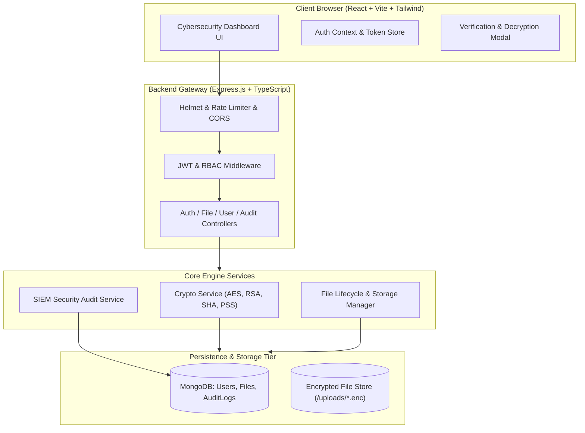
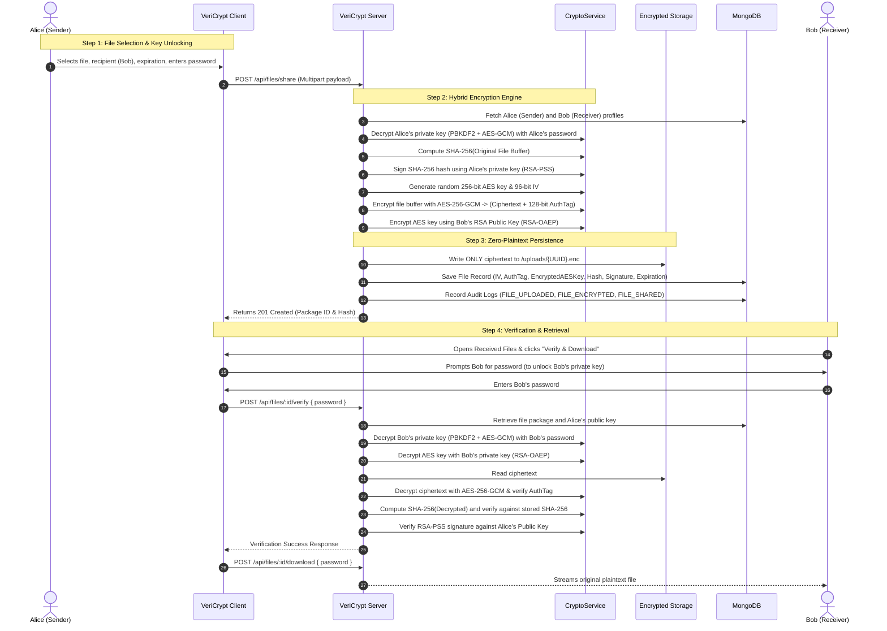

# VeriCrypt — System Architecture & Workflow

## 1. High-Level Architectural Diagram

---

## 2. End-to-End Hybrid Encryption & Transmission Workflow

### Step-by-Step Sequence:

---

## 3. Storage Separation & Principle of Least Privilege
1. **Persistent Filesystem (`/uploads/`):** Contains **only** high-entropy encrypted blobs (`.enc`). Even in the event of an arbitrary physical disk theft, the contents are indistinguishable from random noise and unreadable without both the private RSA key and the user's password.
2. **Database Collections:**
   - `users`: Contains user metadata, bcrypt password hashes, SPKI public keys, and password-encrypted private key bundles.
   - `files`: Encapsulated AES session keys, IVs, GCM authentication tags, SHA-256 digests, and RSA-PSS signatures.
   - `auditLogs`: Structured immutable audit entries without sensitive cryptographic key material.
