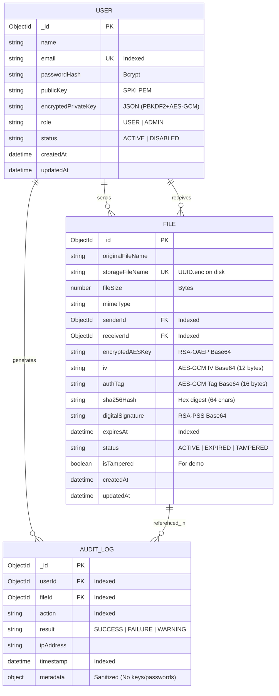

# CryptaShare — Database Design & Schema Specifications

## 1. Overview
CryptaShare utilizes **MongoDB** via the Mongoose Object Data Modeling (ODM) library. The database schema strictly adheres to the principle of **Zero-Plaintext Persistence**:
- No plaintext passwords (stored only as bcrypt salted hashes).
- No plaintext private keys (persisted as PBKDF2 + AES-256-GCM cipher bundles).
- No plaintext file payloads (only encrypted file references, AES-GCM IVs, authTags, RSA-OAEP encapsulated keys, SHA-256 hashes, and RSA-PSS signatures).

---

## 2. Entity-Relationship Model

---

## 3. Detailed Collection Specifications

### 3.1 `users` Collection
Stores user profiles and cryptographic public/protected credentials.

| Field Name | BSON Type | Constraints | Description |
|---|---|---|---|
| `_id` | ObjectId | Primary Key | Unique user identifier. |
| `name` | String | Required, trimmed | User's full display name. |
| `email` | String | Required, unique, lowercase | Authentication and recipient identifier. Indexed. |
| `passwordHash` | String | Required | Bcrypt hash (Cost factor 12) with salt. |
| `publicKey` | String | Required | 2048-bit RSA Public Key in SPKI PEM format. |
| `encryptedPrivateKey` | String | Required | JSON bundle containing `{ salt, iv, authTag, encryptedData }`. |
| `role` | String | Enum: `USER`, `ADMIN` | Role-based authorization. Default: `USER`. |
| `status` | String | Enum: `ACTIVE`, `DISABLED` | Admin account governance. Default: `ACTIVE`. |
| `createdAt` | Date | Timestamp | Account generation time. |

### 3.2 `files` Collection
Maintains encrypted file packages. **Never holds plaintext files.**

| Field Name | BSON Type | Constraints | Description |
|---|---|---|---|
| `_id` | ObjectId | Primary Key | Unique file package identifier. |
| `originalFileName` | String | Required, sanitized | Display name of the file presented upon decryption. |
| `storageFileName` | String | Required, unique | Random UUID filename (`{uuid}.enc`) in storage folder. |
| `fileSize` | Number | Required | Original payload size in bytes. |
| `mimeType` | String | Default: `application/octet-stream` | MIME type for HTTP content headers. |
| `senderId` | ObjectId | Ref: `User`, Required, indexed | Cryptographic creator and RSA-PSS signer. |
| `receiverId` | ObjectId | Ref: `User`, Required, indexed | Designated recipient and RSA-OAEP key holder. |
| `encryptedAESKey` | String | Required, Base64 | 256-bit AES key encrypted with receiver's RSA public key. |
| `iv` | String | Required, Base64 | 96-bit (12 bytes) Initialization Vector for AES-GCM. |
| `authTag` | String | Required, Base64 | 128-bit (16 bytes) Galois authentication tag. |
| `sha256Hash` | String | Required, Hex (64 chars) | Pre-encryption cryptographic digest of original file. |
| `digitalSignature` | String | Required, Base64 | RSA-PSS signature created with sender's private key. |
| `expiresAt` | Date | Nullable, indexed | Optional access expiration date/time. |
| `status` | String | Enum: `ACTIVE`, `EXPIRED`, `TAMPERED` | Operational status of the package. |
| `isTampered` | Boolean | Default: `false` | Flag indicating demonstration byte corruption. |

### 3.3 `auditLogs` Collection
Security Information and Event Management (SIEM) records.

| Field Name | BSON Type | Description |
|---|---|---|
| `_id` | ObjectId | Unique audit log ID. |
| `userId` | ObjectId | Associated actor (nullable for failed initial login). |
| `fileId` | ObjectId | Associated file package (when applicable). |
| `action` | String | Security event name (e.g., `INTEGRITY_VERIFIED`). |
| `result` | String | `SUCCESS`, `FAILURE`, or `WARNING`. |
| `ipAddress` | String | Client remote IP address. |
| `timestamp` | Date | Recorded time of occurrence. |
| `metadata` | Object | Sanitized auxiliary details (all passwords/keys redacted). |
